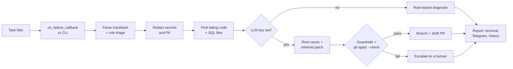

# 🩺 Dr. Dag

[](https://github.com/GitFakhriddinov/dr-dag/actions/workflows/ci.yml)


📖 **Read the story behind it:** [On-call assistant that reads failed Airflow logs so your team doesn't have to](https://medium.com/@fbakhtiyorjon/on-call-assistant-that-reads-failed-airflow-logs-so-your-team-doesnt-have-to-dabe32a3c21a) (Medium)

**An on-call assistant for Apache Airflow.** When a task fails, Dr. Dag reads the log, finds the
line of your code that broke, explains the root cause, and — only when it is safe — proposes a
minimal fix as a **draft** pull request. It also reviews DAG and SQL code for the anti-patterns that
cause most of those failures in the first place.

```text
$ dagdoctor fix examples/logs/clickhouse_missing_column.log --repo examples

## 🩺 Dr. Dag: `shop_daily_sales` / `build_rollup`
**Verdict:** 🩹 Patch proposed — passed all guardrails
**Category:** `missing_column` · **Confidence:** 93% · **Source:** llm

### Root cause
sql/shop_daily_sales.sql sums a column called `amont`, which does not exist in raw.orders.
ClickHouse rejected the query with UNKNOWN_IDENTIFIER and suggested `amount` ...

### Proposed patch
-    sum(amont)         AS revenue
+    sum(amount)        AS revenue
```

> **Background.** I built the first Dr. Dag at my day job, where it watches a production Airflow
> deployment around the clock. This repository is a clean-room open-source rewrite of the idea:
> it contains none of my employer's code, DAGs, schemas, prompts or data. The examples use a
> made-up online shop.

## Why

Most Airflow failures are boring: a renamed column, a missing package, a database that restarted,
a query that ran out of memory. Someone still has to open the log, scroll past 200 lines of
framework noise, find the real exception, open the right DAG and SQL file, and decide whether to
retry, fix, or escalate. Dr. Dag does that first pass in seconds, so the human starts from a
diagnosis instead of a stack trace.

## How it works



1. **Triage without AI.** 16 rules (plus a generic Python-exception fallback) recognise the common failure classes (out of memory, timeouts,
   auth errors, missing tables/columns, SQL syntax, type mismatches, missing modules, network
   errors, rate limits, killed workers, upstream failures…) across ClickHouse, PostgreSQL and
   Python. Each rule knows whether the failure is worth retrying, fixable in code, or a job for a
   human. This works offline and is fully deterministic.
2. **Find the code.** The traceback is mapped from worker paths (`/opt/airflow/dags/...`) to your
   repository, library frames are skipped, and the failing function plus any `.sql` files it loads
   are collected.
3. **Redact.** Passwords in connection URIs, `key=value` secrets, API/GitHub/Telegram/AWS tokens,
   e-mails and phone numbers are removed before anything is sent anywhere.
4. **Diagnose.** With `ANTHROPIC_API_KEY` set, Claude gets the triage, the log excerpt and the
   code, and returns a root cause plus an optional unified diff as structured JSON. Without a key
   (or if the call fails), Dr. Dag falls back to the rule-based diagnosis.
5. **Guardrails.** A patch is only accepted if it touches files under `dags/`, `sql/`, `include/`
   or `plugins/`, stays under 60 changed lines, adds nothing that looks like a secret, avoids
   config/credential files, has no path traversal, and passes `git apply --check`.
6. **Act.** `retry` for transient failures, `patch` for a validated fix (committed on a new branch
   and opened as a **draft** PR — a human always merges), `escalate` for everything else.

## Quick start

Python 3.10+, no runtime dependencies.

```bash
git clone https://github.com/GitFakhriddinov/dr-dag && cd dr-dag
pip install -e .

# Rule-based diagnosis of the example logs (no API key needed)
dagdoctor diagnose examples/logs/postgres_connection_refused.log
dagdoctor diagnose examples/logs/clickhouse_memory_limit.log --json

# Full fix flow, offline: replays a saved model reply instead of calling the API
dagdoctor fix examples/logs/clickhouse_missing_column.log \
  --repo examples --replay-llm examples/llm/missing_column.json

# Static review of DAGs and SQL
dagdoctor review examples
```

With a real model:

```bash
export ANTHROPIC_API_KEY=...            # optional; DAGDOCTOR_MODEL overrides the model
dagdoctor fix path/to/task.log --repo /path/to/airflow-repo             # dry run
dagdoctor fix path/to/task.log --repo /path/to/airflow-repo --apply     # commit on a branch
GITHUB_TOKEN=... dagdoctor fix path/to/task.log --repo /path/to/airflow-repo \
  --open-pr --github-repo you/airflow-repo --base main                   # push + draft PR
```

If your DAGs live somewhere else inside the worker, map the path:
`--path-map /usr/local/airflow/dags=airflow/dags`.

## Use it from Airflow

```python
from dagdoctor.callback import make_failure_callback
from dagdoctor.notify import send_telegram

default_args = {
    "owner": "analytics",
    "retries": 2,
    "on_failure_callback": make_failure_callback(
        repo_root="/opt/airflow",                      # where dags/ and sql/ live
        history_path="/opt/airflow/logs/dagdoctor.jsonl",
        notifier=send_telegram,                        # or any callable(str)
    ),
}
```

The callback rebuilds the traceback from Airflow's context, diagnoses it and sends the report.
It never raises: if Dr. Dag itself breaks, it logs the error and your task's normal failure
handling continues. Telegram needs `DAGDOCTOR_TELEGRAM_TOKEN` and `DAGDOCTOR_TELEGRAM_CHAT_ID`.

## Static review

`dagdoctor review <folder>` parses files with `ast` (it never imports your DAGs, so it is safe in
CI) and reports:

| Rule | Severity | Check |
|---|---|---|
| DD001 | warning | No `retries` configured |
| DD002 | error | Dynamic `start_date` (`datetime.now()`, `days_ago()`) |
| DD003 | info | `catchup` not set explicitly |
| DD004 | error | Hard-coded secret or connection URI with a password |
| DD005 | warning | `Variable.get`, `get_connection`, HTTP or `read_sql` calls at import time |
| DD006 | info | `schedule_interval` (deprecated in Airflow 2.4, removed in 3.0) |
| DD007 | info | No `owner` in `default_args` |
| DD008 | info | DAG has no `tags` |
| DD009 | warning | No `execution_timeout` or `dagrun_timeout` |
| DD010 | warning | Bare `except:` |
| SQL001 | info | `SELECT *` |
| SQL002 | error | `DELETE`/`UPDATE` without `WHERE` |

`--fail-on error|warning|never` controls the exit code, so it drops straight into a CI job.

## Monthly digest

Every diagnosis can be appended to a JSON Lines history (`--history file.jsonl`, or
`history_path=` in the callback). `dagdoctor stats file.jsonl --month 2026-10` turns it into a
digest: failures by category, the noisiest DAGs, and the share handled without a human.

## Project layout

```text
src/dagdoctor/
  triage.py     rule engine, traceback parser, dag/task id extraction
  redact.py     secret and PII scrubbing (log mode vs. patch-safe code mode)
  context.py    worker-path mapping, failing function, referenced SQL files
  llm.py        stdlib-only Messages API client, prompt, response validation
  patch.py      patch guardrails
  diagnose.py   the pipeline that ties it together
  github.py     branch, commit, draft PR
  review.py     static DAG/SQL review
  stats.py      history and digest
  callback.py   Airflow on_failure_callback
  cli.py        dagdoctor diagnose | fix | review | stats
examples/       a demo shop: DAGs, SQL, real-looking failure logs, a saved model reply
tests/          75 tests, no network needed
```

## Development

```bash
pip install -e ".[dev]"
pytest -q
ruff check . && ruff format --check src tests
```

## Roadmap

- Answer free-form questions about the data platform in a Telegram group, using the same
  context collection.
- Pull logs straight from the Airflow REST API instead of files.
- Learn from merged and rejected fix PRs which patch types to trust.

## License

MIT © Bakhtiyor Fakhriddinov
